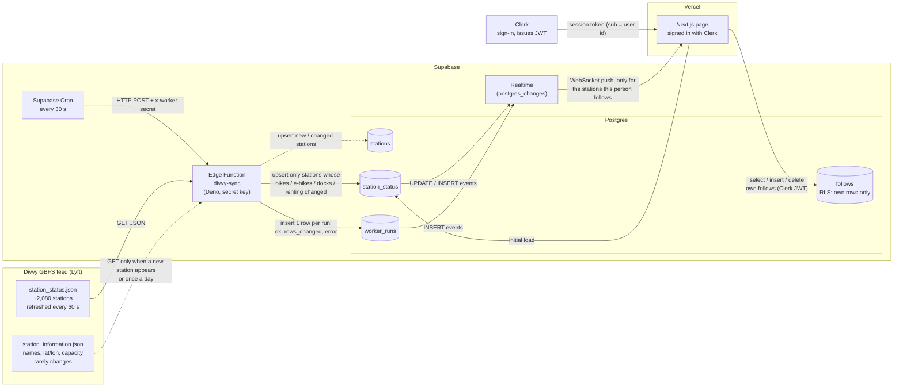

# Data flow

Drawn before any code was written (Step 3 of the assignment).

## What each part sends to the next

| From → To | What is sent | What breaks if it changes |
|---|---|---|
| Divvy → worker | `station_status` JSON: `station_id`, `num_bikes_available`, `num_ebikes_available`, `num_docks_available`, `is_renting`, `last_reported` | If Divvy renames a field or moves the URL, the worker's validation fails, the run is recorded with `ok = false`, and the page shows **down**. Old numbers stay in the DB but go **stale**. |
| Cron → worker | An HTTP POST every 30 s with a shared secret header | If the secret is rotated in only one place, every call gets 401 and no runs are recorded: the page shows **stale**, not down. |
| Worker → `station_status` | Only rows whose counts or renting flag changed (~80 of 2,079 per 3 min) | If the worker wrote every row each run, Realtime would push ~2,000 messages per run per viewer and burn the free tier in hours. |
| Worker → `worker_runs` | `started_at`, `finished_at`, `ok`, `rows_changed`, `error` | The page's freshness and down states read this table; without it the page can't tell "nothing changed" from "worker is dead". |
| DB → Realtime → page | Change events for `station_status` and `worker_runs` | Realtime needs the table in the `supabase_realtime` publication, a `select` grant, and an RLS policy. Missing any one = silent nothing. |
| Clerk → page → DB | A JWT whose `sub` is the Clerk user id | RLS on `follows` compares `user_id` with `auth.jwt()->>'sub'`. If the Clerk ↔ Supabase integration is off, every follow query returns empty. |

## Why "changed" means counts, not `last_reported`

Two calls three minutes apart (2026-11-02, 20:30 → 20:33 CST):

- 1,119 stations had a new `last_reported` (they checked in)
- only **80** had different bike / e-bike / dock counts

So the worker compares the counts and the renting flag and ignores a newer `last_reported` on its own. That cuts writes, and Realtime messages, by about 14×.
